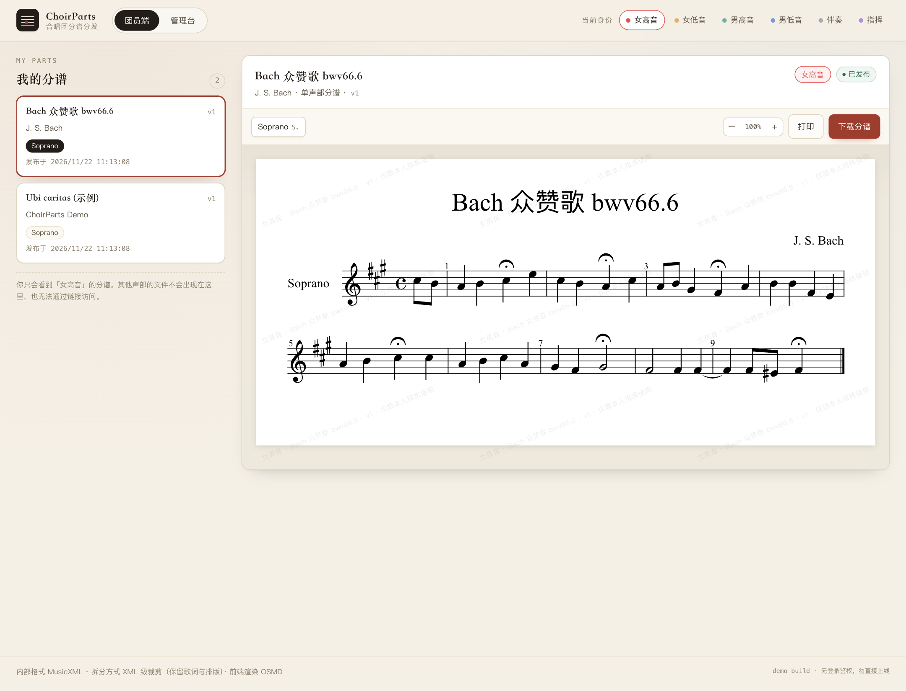
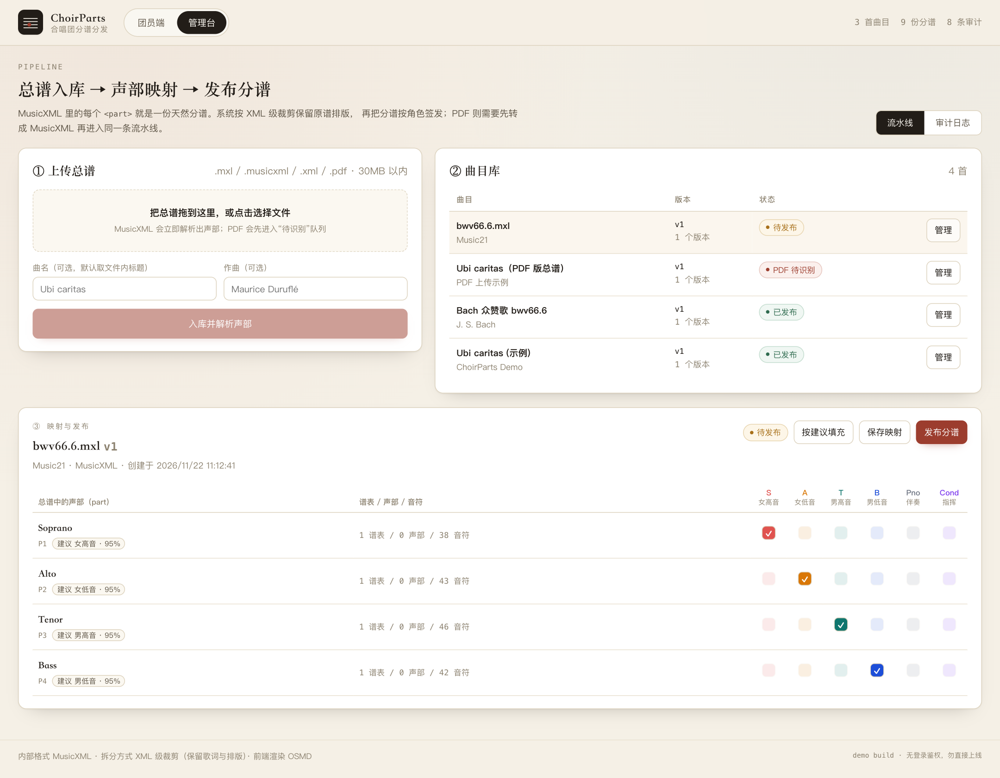

# ChoirParts · 合唱团分谱分发

把一份合唱总谱（MusicXML）拆成各声部独立分谱，按角色发放给团员；团员只能看到自己那一份。
包含一套可直接跑起来的演示：FastAPI 后端 + React/OSMD 前端 + 三条示例数据。





## 能做什么 / 不能做什么

**能**
- 上传 `.musicxml / .mxl`，自动解析出总谱里的每个 `<part>`，按名称识别 S/A/T/B/伴奏/指挥（带置信度）
- 管理员在「角色 × part」矩阵里复核、保存、发布 → 每个角色拿到独立分谱文件
- 拆分用 **XML 级裁剪**：只删掉别的声部，歌词、力度、表情、移调、连音线都原样保留
- 团员端用 OSMD 渲染分谱，支持缩放、打印、水印、短时签名下载链接
- **排练播放器**：按谱面为每个声部生成独立音轨，叠在谱面上播放；可任意 solo / mute 任一
  声部，所有角色的播放页完全一致（各声部从同一时刻起播，采样级同步）
- PDF 上传后进入「待识别」队列，转好 MusicXML 回填即可走同一条流水线
- 版本号 + sha256 指纹 + 审计日志（取谱/签发/下载都留痕）

**不能（有意留白，别指望它）**
- 不能把 PDF 直接拆声部。PDF 里没有声部语义，必须 OMR（Audiveris / MuseScore）转 MusicXML 后人工校对
- 不能把「SATB 叠在钢琴双谱表上的一个 part」自动切开。这类 part 会被标成不可拆，发布时拦下并提示先拆 part
- 不能从录音生成分谱
- 音频是**合成音色**（加性合成器，钢琴质感），不是人声；目的是听音高、节奏与声部进出，
  不是拿来做演出音源。要更真实就得接 SoundFont + fluidsynth 或离线渲染
- 演示版没有登录：角色是前端切换的。数据层已按角色隔离，但**上线前必须接鉴权**（见下）

## 快速启动

```bash
cd backend
python3 -m venv .venv && .venv/bin/pip install -r requirements.txt

# 生成演示素材（已生成则跳过）
.venv/bin/python tools/make_demo_score.py      # 自制 16 小节 SATB + 钢琴总谱
.venv/bin/python tools/make_demo_pdf.py        # 用 Verovio 排成 PDF（需要本机 Chrome）
.venv/bin/python tools/fetch_public_score.py --corpus bwv66.6   # 真实巴赫众赞歌（可选）

cd ../frontend && npm install && npm run build
cd ../backend && .venv/bin/uvicorn app.main:app --port 8000
```

打开 <http://127.0.0.1:8000>。前端改动用 `cd frontend && npm run dev`（5173 端口，`/api` 已代理到 8000）。

首次启动会把 `data/demo` 与 `data/samples` 里的素材灌进 SQLite，然后自动发布一次分谱，
所以打开页面就能看到三条数据：

| 数据 | 用途 |
| --- | --- |
| `Ubi caritas (示例)` | 自制 SATB + 钢琴，5 个 part，歌词完整，验证「四声部 + 伴奏」 |
| `Ubi caritas（PDF 版总谱）` | 同一首曲子的 PDF，演示「PDF 待识别 → 回填 MusicXML」 |
| `Bach 众赞歌 bwv66.6` | music21 语料导出的真实四声部众赞歌，验证真谱解析 |

## 目录

```
backend/
  app/
    main.py            FastAPI 入口（同时托管前端构建产物）
    api.py             全部 HTTP 接口
    pipeline.py        入库 → 解析 → 映射 → 发布 → 取谱
    store.py           SQLite 表结构与连接
    seed.py            首次启动灌演示数据
    services/
      musicxml.py      MusicXML 解析、part 画像、XML 级裁剪拆分
      role_detect.py   声部名 → 角色（中英文关键词 + 置信度）
      audio.py         MusicXML → MIDI → 合成 → MP3（声部音轨）
  tools/               生成演示谱 / 生成 PDF / 拉真实语料 / 浏览器冒烟测试
  tests/               23 个测试：拆分保真、MXL、多声部拒绝、声部音频、API 全链路
  data/                demo 素材、samples、SQLite、生成的分谱与音频
frontend/
  src/components/      MemberView（团员）、AdminView + VersionEditor（管理）、
                       ScoreViewer（OSMD）、PartMixer（Web Audio 多轨播放）
docs/architecture.md   技术路线与取舍说明
```

## 接口

| 方法 | 路径 | 说明 |
| --- | --- | --- |
| GET | `/api/meta` | 角色字典 + 统计 |
| GET | `/api/scores` | 曲目列表（含最新/已发布版本） |
| POST | `/api/scores` | multipart 上传，musicxml/mxl/pdf |
| POST | `/api/scores/{id}/versions` | 总谱改版，新建版本 |
| GET | `/api/versions/{id}` | 版本详情：parts、建议角色、映射、已生成资产 |
| PUT | `/api/versions/{id}/assignments` | 保存「角色 → part」映射 |
| POST | `/api/versions/{id}/publish` | 生成分谱并发布（`force=true` 允许整段保留） |
| POST | `/api/versions/{id}/attach-musicxml` | 给 PDF 版本回填 OMR 结果 |
| GET | `/api/versions/{id}/pdf` | PDF 原件预览 |
| GET | `/api/library/{role}` | 某角色可见的已发布分谱 |
| GET | `/api/assets/{id}?role=` | 取分谱 MusicXML（审计一次 `view`） |
| POST | `/api/assets/{id}/sign?role=` | 签发 10 分钟有效的下载 token |
| GET | `/api/dl/{token}` | 凭 token 下载（一次性过期） |
| GET | `/api/play/{version_id}` | 排练播放列表：该版本**全部**声部的音轨与时长（不分角色） |
| GET | `/api/audio/{version_id}/{part_id}` | 某声部的 MP3（支持 Range，可拖动进度） |
| GET | `/api/audit?limit=` | 审计日志 |

## 拆分是怎么做的

1. 解析总谱，得到每个 `<part>` 的谱表数、声部编号、音符数、谱号。
2. 名称归一化：`Soprano / S. / 女高音 / S1` → `S`，`Piano / 伴奏` → `ACCOMP`，给出置信度；
   低置信度的留给管理员在矩阵里勾。
3. 发布时对每个 (角色, part) 深拷贝总谱、删掉其他 `<part>` 和 `<score-part>`，
   清掉 `new-system / new-page` 等分页提示让单声部重新排版，写入水印元数据，落盘并算 sha256。
4. 团员端只查得到自己角色的 asset；下载走短时 token，取谱与下载都进审计表。

细节与取舍见 [docs/architecture.md](docs/architecture.md)。

## 音频是怎么生成的

1. 对每个 part 用 `mx.extract_parts()` 裁出一份干净的分谱（不带水印），交给 **Verovio** 转成 MIDI。
2. 用 `mido` 解析 MIDI（`MidiFile` 迭代时已把时间换算成秒、并跟随 set_tempo），得到音符事件。
3. 用 numpy 写一个加性合成器：10 个泛音 + 轻微非谐性 + 双振荡器微失谐 + ADSR 包络，钢琴质感；
   `lameenc` 编成 128kbps 单声道 MP3，落盘到 `data/audio/<version>/`，元数据进 `part_audio` 表。
4. 前端把每条音轨 `decodeAudioData` 成 AudioBuffer，用 **Web Audio** 从同一个
   `ctx.currentTime` 起播 → 采样级同步；solo / mute 只改各自 GainNode，播放中切换不断音。
   （用 N 个 `<audio>` 标签会各走各的时钟，几秒后就互相漂移。）

两个必须踩过的坑，代码里已处理：

- **速度标记只存在于一个声部**。总谱的 `<sound tempo>` 通常只写在最上面的声部里，逐声部单独
  渲染会让那个声部按 76 BPM、其它声部回落到 Verovio 默认 120 BPM，同一首曲子直接错位。
  所以先用 `collect_tempos()` 从总谱抽出速度表，再统一写回每份分谱。
- **Verovio 的字体资源绑在主线程**。FastAPI 的同步接口跑在线程池里，不显式
  `setResourcePath()` 就会报 "font resources are not available"，`loadData()` 返回 False，
  看起来像「MusicXML 解析失败」，其实跟文件无关。

音轨是**首次访问播放接口时按需生成**并缓存（不阻塞发布）；一个 51 秒的 5 声部曲子约 8 秒生成完。

## 真实曲谱从哪里来

- **MusicXML**：<https://www.cpdl.org> 搜 SATB 作品，作品页里选 MusicXML；<https://openscore.org> 也有整套公开曲目
- **PDF 总谱**：<https://imslp.org> 搜作品 → Full Score
- 注意：这两个站点有 Cloudflare / Cookie 拦截，脚本直连会 403，**用浏览器手动下载**再把文件拖进管理台最省事
  （`tools/fetch_public_score.py` 支持直链，也支持 music21 语料导出）

## 上生产前必须补

1. **鉴权**：`role` 必须来自登录态，`/api/assets/{id}` 要校验 `asset.role == 当前用户角色`；管理接口单独鉴权。
2. **PDF 水印**：现在水印写在 MusicXML 元数据 + 前端叠层；正式版应在服务端排版时烧进 PDF。
3. **版本通知**：发布新版本时通知相关角色，旧版本标记过期，避免有人练旧谱。
4. **印刷级分谱**：接 `mscore -o part.pdf part.musicxml` 或 LilyPond 重新雕刻；OSMD 的连续版式适合屏幕，不适合直接印刷。
5. **许可**：Audiveris / Satie 为 AGPLv3、MuseScore 为 GPLv2，独立进程调用与打包进产品的义务不同，商用前逐个核对。
   本项目自身依赖 FastAPI(BSD)、lxml(BSD)、OSMD(MIT)、Verovio(MIT)、mido(MIT)、lameenc(LGPL)。
6. **音轨预热与内存**：音轨是首次访问时按需生成的，第一下会有几秒等待；可以改成发布后由后台任务预热。
   另外前端把整条音轨解码进内存（约 10MB/分钟/声部），一首 5 分钟的 SATB+钢琴约 250MB，
   曲子长或声部多时要换成流式播放（`<audio>` + `MediaElementSource`）或降到 22.05kHz 单声道。
7. **音频范围**：播放页对所有人暴露全部声部音轨（这是产品要求：大家听到同样的素材才能一起练），
   但谱面仍按角色隔离。上线接鉴权时，`/api/play` 应当只对「本团成员」开放，而不是对所有登录用户开放。

## Git 与协作

项目按 Git 工作流管理：`main` 可发布，功能走 `feat/*` 分支 + PR，合并前跑 CI，发布打 tag。
完整命令与约定见 [docs/git-workflow.md](docs/git-workflow.md)。

```bash
cd choir-score-hub
git init -b main
git add .                                   # 先确认 .gitignore 已生效
git commit -m "feat: 合唱团分谱分发 MVP"
git remote add origin git@github.com:<你的账号>/choirparts.git
git push -u origin main

# 之后的迭代
git switch -c feat/sub-role
# ... 改代码、跑测试 ...
git add -A && git commit -m "feat(role): 支持 S1/S2 子声部"
git push -u origin HEAD
gh pr create --fill
```

> 注意：本机 `~` 家目录本身是一个 Git 仓库，不要在家目录里 `git add .`；
> 本项目应作为独立仓库在 `choir-score-hub/` 内初始化。

## 课件

面向课堂讲解的 21 页 HTML 幻灯片：[docs/合唱团分谱系统-开发流程.html](docs/合唱团分谱系统-开发流程.html)
（← → 翻页，N 看讲稿，P 导出 PDF；源文件与生成脚本在 `docs/deck/`）

## 开发

```bash
cd backend
.venv/bin/python -m pytest -q              # 14 passed
.venv/bin/python tools/smoke_ui.py         # 真浏览器冒烟：截图存 data/screenshots/
```

需要 Playwright 驱动本机 Chrome：`.venv/bin/pip install playwright`（不用下载浏览器）。
